<div align="center">

# 💪 Pyrova
### **The Ultimate AI-Powered Fitness & Wellness Ecosystem**

[](https://flutter.dev/)
[](https://dart.dev/)
[](https://nodejs.org/)
[](https://expressjs.com/)
[](https://www.mysql.com/)
[](https://deepmind.google/technologies/gemini/)
[](LICENSE)

**Empowering users with AI-powered fitness coaching, personalized workout plans, nutrition tracking, and real-time health insights.**

---

[Explore Features](#-key-features) • [Visual Showcase](#-app-screenshot-gallery) • [Project Structure](#-project-structure) • [Tech Stack](#-tech-stack)

</div>

---

## 📖 Overview
**Pyrova** is a next-generation fitness, bodybuilding, and wellness platform designed to assist users in transforming their physical health through personalized workout routines, scientific macro-nutrition tracking, and AI-driven coaching. Engineered with precision by **Softece**, the application delivers a complete, holistic ecosystem for fitness beginners, gym regulars, and competitive athletes alike.

---

## ✨ Key Features

- 🤖 **AI Fitness Coach:** Real-time conversational fitness guidance and form advice powered by Google Gemini AI.
- 🏋️ **Goal-Centric Workout Plans:** Personalized training splits for fat loss, muscle hypertrophy, or endurance.
- 🍎 **Macro & Nutrition Tracking:** Log daily meals, calculate caloric deficits/surpluses, and monitor macronutrient distribution.
- 📈 **Performance Analytics:** Interactive charts tracking weight trends, body measurements, volume load, and PR milestones.
- 🔥 **HD Exercise Library:** Comprehensive directory of exercises with targeted muscle group diagrams and movement guides.
- 💧 **Smart Hydration Tracker:** Adaptive daily water intake targets with timely reminders.
- 🎯 **Milestone & Streak Engine:** Earn motivational achievement badges and sustain daily consistency streaks.
- 👥 **Community & Leaderboards:** Share transformation progress, compare milestones, and encourage fellow athletes.

---

## 🖼️ App Screenshot Gallery

### 🚀 Onboarding & Workout Exploration
*Intuitive discovery of training routines and daily coaching insights.*

<p align="center">
  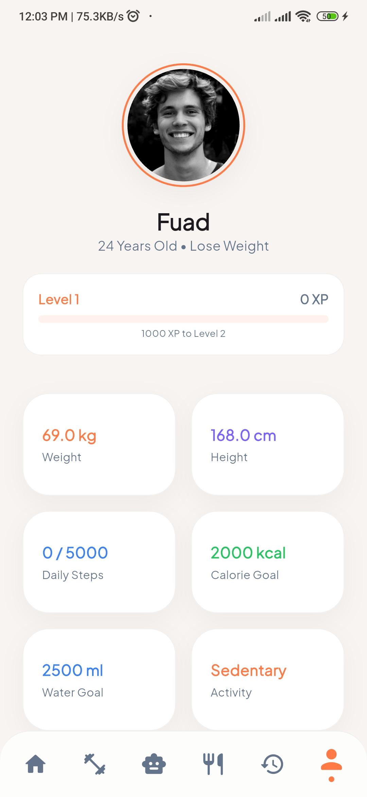
  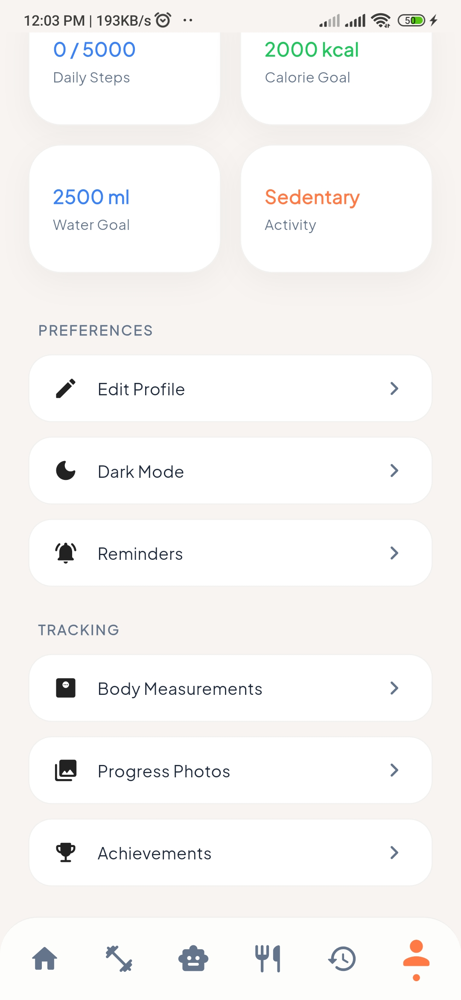
  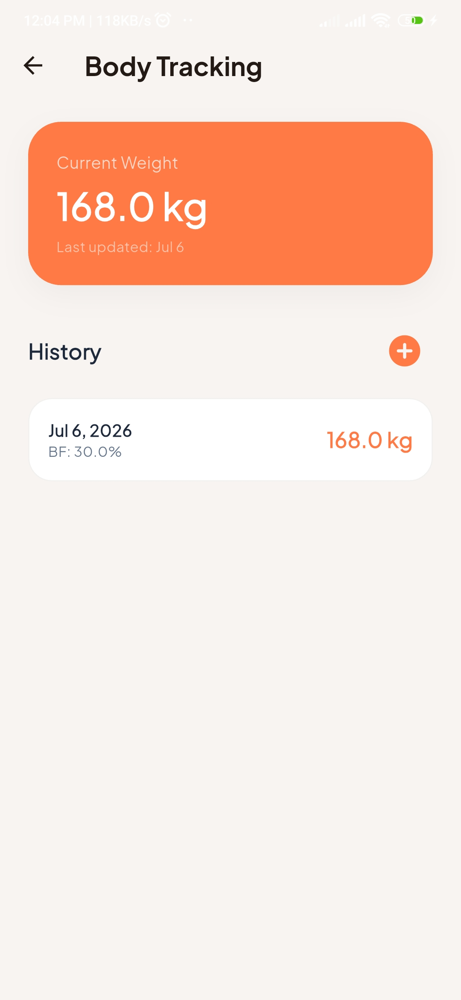
</p>

---

### 🏋️ Active Training & Session Logging
*Real-time rest timers, set trackers, and guided movement execution.*

<p align="center">
  
  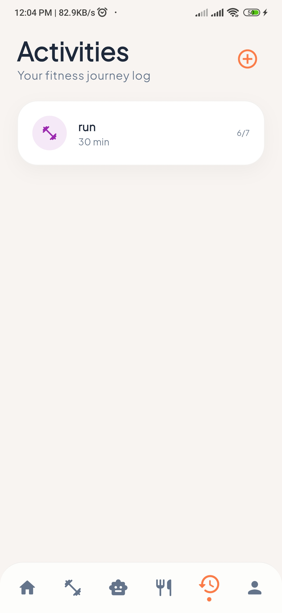
  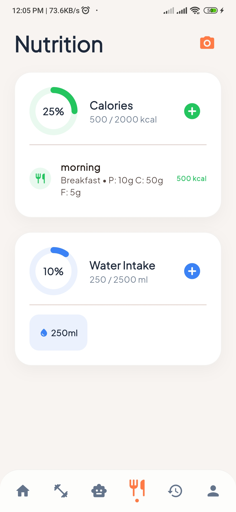
</p>

---

### 🍎 Nutrition, Macros & Water Intake
*Precision tracking of daily calories, protein, carbs, and hydration.*

<p align="center">
  
  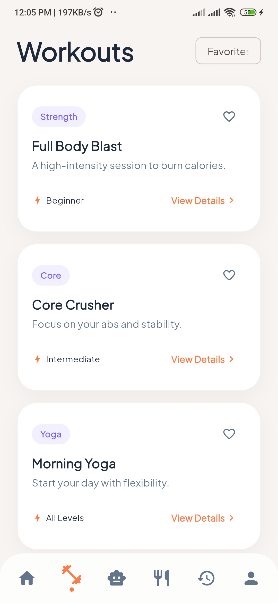
  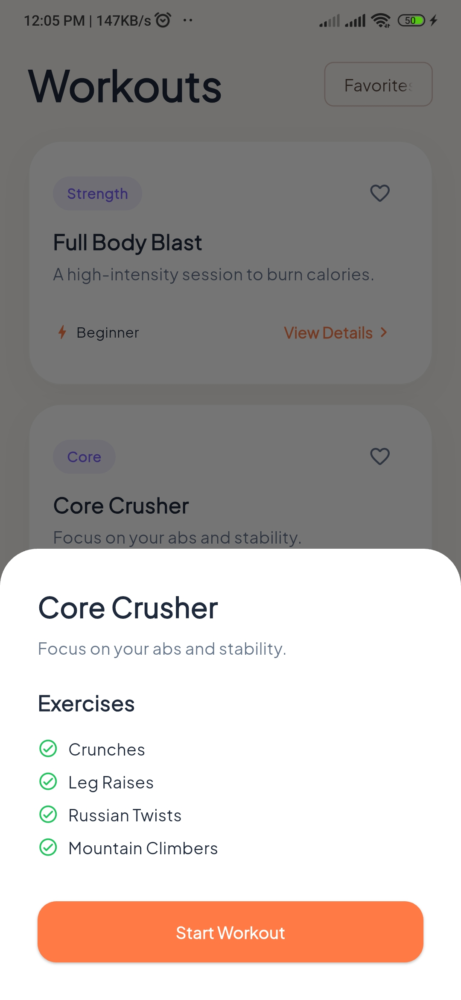
</p>

---

### 📈 Analytics & Progress Visualizations
*Comprehensive telemetry of weight change, body composition, and performance.*

<p align="center">
  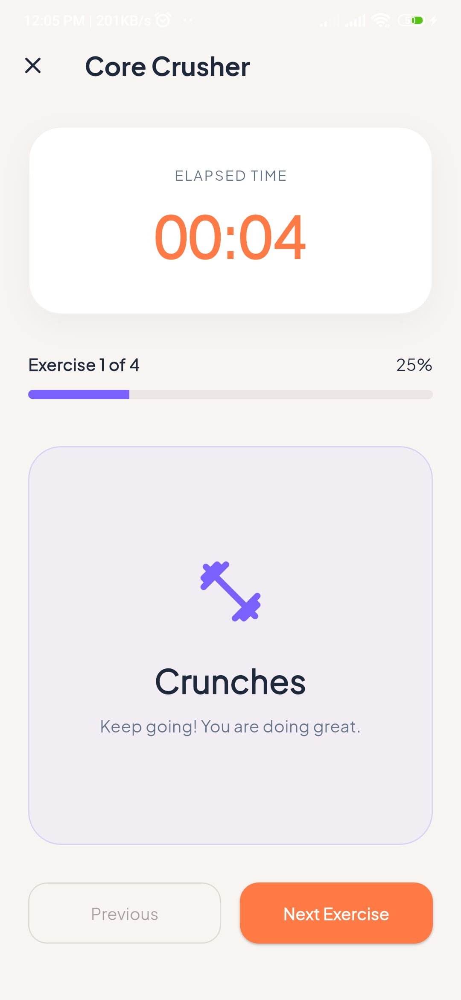
  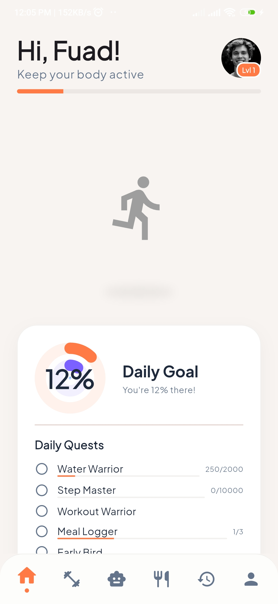
  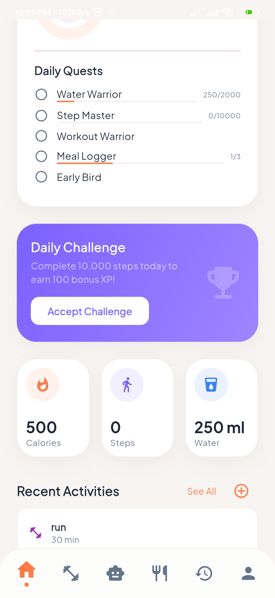
</p>

---

### 👤 Profile, Badges & Customization
*Personalized goals, achievement shelves, and app configuration.*

<p align="center">
  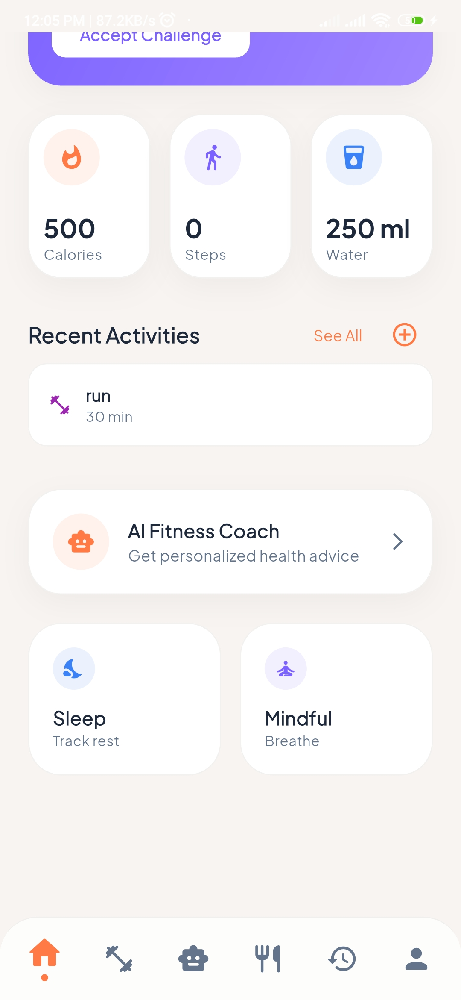
  
  
</p>

---

## 📁 Project Structure

```text
Pyrova/
├── client/                      # Flutter Mobile Application
│   ├── lib/                     # Dart source code
│   │   ├── models/              # User, Workout, Nutrition & Analytics models
│   │   ├── screens/             # UI layers (Dashboard, Workouts, Tracker, Profile)
│   │   ├── services/            # REST API communication & Gemini client
│   │   └── widgets/             # Custom charts, timer cards & progress bars
│   ├── assets/                  # Icons, illustrations, and Lottie animations
│   └── pubspec.yaml
├── server/                      # Node.js + Express REST API Backend
│   ├── config/                  # Database connections & environment setup
│   ├── controllers/             # Workout logic, Nutrition calculus & User auth
│   ├── models/                  # MySQL relational schemas
│   ├── routes/                  # API endpoints
│   ├── index.js                 # Server entry point
│   └── package.json
└── README.md
```

---

## 🛠️ Tech Stack

| Layer | Technology |
| :--- | :--- |
| **Mobile App** | Flutter (Dart SDK 3.x) |
| **Backend API** | Node.js + Express.js |
| **Database** | MySQL (User history, workouts, meal logs) |
| **AI Engine** | Google Gemini API (`generativeai`) |
| **State Management** | Provider / Riverpod |
| **Visualization** | `fl_chart` for dynamic progress trends |
| **Authentication** | Firebase Auth & JWT |

---

## ⚙️ Getting Started

### Backend Setup
```bash
cd server
npm install
# Configure MySQL credentials in .env
npm start
```

### Mobile App Setup
```bash
cd client
flutter pub get
flutter run
```

---

## 📄 License
Distributed under the MIT License. See `LICENSE` for more information.

<div align="center">

**Developed with ❤️ by Fuad**  
*Developed by Softece*  
*Pyrova*

</div>
